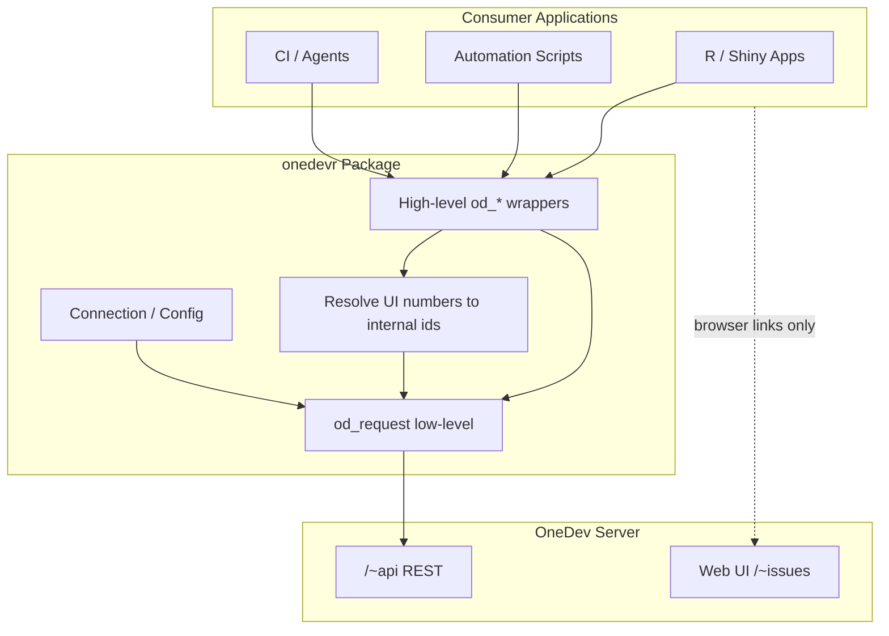

# onedevr — Plan für ein R-Paket (OneDev REST API Client)

**Stand:** 2026-10-23 (Review/Revision; Paketversion 0.5.2 + `development`)  
**Status:** Phasen 0–4 abgeschlossen, Paket auf GitHub veröffentlicht. Dieses Dokument ist die **Spezifikation** (Ziel, Konventionen, bekannte API-Quirks). **Maßgeblich für den Ist-Stand sind** `R/*.R`, `NAMESPACE`, `DESCRIPTION`, `NEWS.md` und `ROADMAP.md`; Code-Snippets in §7 und §13–§14 sind historische Entwurfsvorlagen und können von der Implementierung abweichen.  
**Ziel:** Eigenständiges R-Paket `onedevr` (Display-Name: **onedevR**), analog zu [gitlabr](https://thinkr-open.github.io/gitlabr/), das die OneDev-REST-API kapselt.

---

## Inhaltsverzeichnis

1. [Executive Summary](#1-executive-summary)
2. [Motivation & Referenzmodell (gitlabr)](#2-motivation--referenzmodell-gitlabr)
3. [Funktionsumfang MVP](#3-funktionsumfang-mvp)
4. [Abhängigkeiten & öffentliche API](#4-abhängigkeiten--öffentliche-api)
5. [Architektur](#5-architektur)
6. [API-Design](#6-api-design)
7. [Referenz-Implementierung (Code-Snippets)](#7-referenz-implementierung-code-snippets)
8. [Umgebungsvariablen & Konfiguration](#8-umgebungsvariablen--konfiguration)
9. [UI-Nummern vs. interne API-IDs](#9-ui-nummern-vs-interne-api-ids)
10. [Bekannte API-Quirks](#10-bekannte-api-quirks)
11. [Phasen, Meilensteine & Akzeptanzkriterien](#11-phasen-meilensteine--akzeptanzkriterien)
12. [Consumer-Integration](#12-consumer-integration)
13. [Paket-Skeleton](#13-paket-skeleton)
14. [Test-Strategie](#14-test-strategie)
15. [Zukünftige API-Abdeckung](#15-zukünftige-api-abdeckung)
16. [Referenzen & Links](#16-referenzen--links)
17. [Risiken & offene Fragen](#17-risiken--offene-fragen)
18. [Umsetzungs-Checkliste](#18-umsetzungs-checkliste)

---

## 1. Executive Summary

| Aspekt | Entscheidung |
|--------|--------------|
| **Paketname (CRAN)** | `onedevr` (lowercase, R-Konvention) |
| **Display-Name** | onedevR |
| **Funktionspräfix** | `od_*` |
| **HTTP-Stack** | `httr2` + `jsonlite` |
| **Auth** | Bearer Token (Default) und Basic Auth (`username` + `password`/`token`) |
| **Lizenz** | MIT (entschieden) |
| **Umfang (Ist)** | Issues, Projekte, Iterations, Builds/Jobs, Pull Requests, Repository/Commits, Packages, Users/Groups, Artefakte, Streaming, Cache, Batch/Parallel |
| **Nicht im Paket** | App-spezifische Web-URL-Builder, Shiny-UI, domänenspezifische Issue-Titel |

**Kernidee:** Zwei Ebenen wie bei gitlabr:

- **Low-level:** `od_request()` — beliebiger REST-Aufruf gegen `https://<host>/~api/...`
- **High-level:** `od_get_issue()`, `od_create_issue()`, `od_query_issues()`, …

---

## 2. Motivation & Referenzmodell (gitlabr + tod)

**Zwei getrennte Referenzen:**

| Rolle | Referenz | Nutzen für onedevr |
|-------|----------|--------------------|
| R-Paket-Architektur (GitLab → R) | [gitlabr](https://thinkr-open.github.io/gitlabr/) | Connection-Objekt, Low-level Escape Hatch, High-level `gl_*` → `od_*` |
| OneDev selbst bedienen (CLI / API-Formen) | [tod](https://github.com/theonedev/tod) | Issue/PR/Build-Refs (`#n`, `project#n`), Query-DSL, Payload-Konventionen — siehe [`cli.md`](https://github.com/theonedev/tod/blob/main/cli.md) |

`onedevr` wrappt **nicht** die `tod`-CLI; es spricht die REST-API direkt an (`httr2`). `tod` ist die kanonische Referenz dafür, *wie* OneDev gemeint ist — nicht die Laufzeitabhängigkeit.

### Was gitlabr liefert

| Ebene | gitlabr | geplantes onedevr-Äquivalent |
|-------|---------|------------------------------|
| Connection | `gl_connection()`, `set_gitlab_connection()` | `od_connection()`, `od_set_connection()` |
| Low-level | `gitlab(req, verb, ...)` | `od_request(method, endpoint, ...)` |
| Issues | `gl_list_issues()`, `gl_create_issue()`, … | `od_query_issues()`, `od_create_issue()`, … |
| Projekte | `gl_list_projects()`, … | `od_resolve_project_id()`, `od_list_projects()` |
| CI/Builds | `use_gitlab_ci()`, Pipeline-Wrapper | Phase 3: `od_query_builds()`, … |
| Vignetten | `vignette("a-gitlabr")` | `vignette("getting-started")`, `vignette("issues-workflow")`, `vignette("function-map")` |

### Warum ein separates Paket?

1. **Wiederverwendung** — R-Projekte, CI-Skripte und Agents nutzen dieselbe API-Logik
2. **Zentrale Pflege** — Payload-Varianten, UI-Nummern-Auflösung, Versionstoleranz an einem Ort
3. **REST-first** — programmatischer Zugriff ohne CLI-Wrapper
4. **Lücke im Ökosystem** — es gibt kein etabliertes R-Paket für OneDev (Stand 2026)

### OneDev vs. GitLab (designrelevant)

| Thema | GitLab | OneDev |
|-------|--------|--------|
| Issue-IDs | global eindeutig | **projektbezogene UI-Nummer** `#NNN` |
| Interne ID | oft identisch mit IID | separates Feld `id` (z. B. `#145` → `id=283`) |
| Query-Syntax | GitLab-spezifisch | `"Number" is "ProjectPath#145"` |
| API-Doku | docs.gitlab.com | **pro Installation:** `https://<host>/~help/api` |
| Auth (Doku) | Private Token | Basic Auth **oder** Bearer Token |
| Self-hosted | üblich | **Standard-Use-Case** |

---

## 3. Funktionsumfang MVP

### Phase 1 — Issue-Core (MVP)

| Modul | Funktionen |
|-------|------------|
| Config | `od_get_config()`, später `od_connection()` |
| HTTP | `od_request()` |
| Projekte | `od_resolve_project_id()`, `od_resolve_project_path()` |
| Issues | `od_query_issues()`, `od_resolve_issue_id()`, `od_get_issue()` |
| Issues (write) | `od_create_issue()`, `od_issue_set_title()`, `od_issue_set_description()`, `od_issue_set_fields()`, `od_issue_transition_state()` |

### Phase 2 — Issues+

| Modul | Funktionen |
|-------|------------|
| Fields | `od_get_issue_fields()` |
| Iterations | `od_list_iterations()`, `od_add_issue_iterations()` |
| Create erweitert | `od_create_issue(..., iteration_ids =)` |

### Phase 3 — Builds & Pull Requests

| Modul | Funktionen |
|-------|------------|
| Builds | `od_query_builds()`, `od_get_build()`, `od_resolve_build_id()` |
| PRs | `od_query_pull_requests()`, `od_get_pull_request()`, `od_resolve_pull_request_id()`, `od_get_pull_request_comments()`, `od_get_pull_request_reviews()` |

### Nach Phase 3 (umgesetzt, siehe `NEWS.md`)

| Version | Inhalt |
|---------|--------|
| 0.2.0–0.3.0 | Query-DSL-Helfer, Tibble-Rückgaben (`options(onedevr.as_tibble)`), Basic Auth |
| 0.4.0 | Projects/Users/Groups, Build-Artefakte, `od_download()` |
| 0.5.0 | Jobs (run/rebuild/cancel), Packages, Repository-/Commit-Helfer |
| 0.5.1 | Dogfood-Hardening: Build-/PR-Status-Keywords, Pagination, Query-DSL |
| 0.5.2 | Titel/Beschreibung: Rohstring zuerst; aggregierte Varianten-Fehler |
| development | `od_resolve_iteration_ids()`, 406-Hinweis, Kommentar-Body-Varianten |

Zusätzlich vorhanden: Batch-Operationen, Parallel/Concurrent-Helfer, Streaming (Build-Logs, Query-Resultate) und optionaler Response-Cache (`R/batch.R`, `R/concurrent.R`, `R/streaming.R`, `R/cache.R`).

### Bewusst außerhalb des Pakets

| Thema | Begründung |
|-------|------------|
| Web-URLs für „Neues Issue“-Formulare | Consumer-spezifisch (Shiny, HTML, JS) |
| Domänen-Titel/Beschreibungen | Gehört in die Anwendung, nicht in den API-Client |
| Issue-Schließen per Commit-Message | OneDev/Git-Workflow der jeweiligen Installation |

---

## 4. Abhängigkeiten & öffentliche API

### DESCRIPTION (Ist-Stand, gekürzt)

```r
Package: onedevr
Title: Access to the OneDev REST API
Version: 0.1.0
Description: R client for the OneDev project management REST API. Provides
    low-level request helpers and high-level convenience functions for
    issues, projects, and (future) builds. Designed for self-hosted OneDev
    instances.
Depends: R (>= 4.2.0)
Imports:
    digest (>= 0.6.0),
    httr2 (>= 1.0.0),
    jsonlite (>= 1.8.0),
    rlang (>= 1.0.0),
    tibble (>= 3.0.0),
    vctrs (>= 0.5.0)
Suggests:
    testthat (>= 3.1.0),
    mockery,
    withr,
    knitr,
    rmarkdown,
    pkgdown,
    future
VignetteBuilder: knitr
Roxygen: list(markdown = TRUE)
Encoding: UTF-8
License: MIT + file LICENSE
```

> Stand: `DESCRIPTION` im Repo ist maßgeblich (u. a. `digest` für Cache-Keys, `tibble`/`vctrs` für Tibble-Rückgaben, `future` optional für parallele Helfer).

### Interne Helfer (nicht exportiert)

```
.od_trim_env
.od_first_non_empty
.od_parse_flag
.od_derive_project_path
.od_normalize_collection
.od_parse_response_body
.od_http_error
.od_prepare_request
.od_resolve_api_url
.od_request_with_variants
```

### Öffentliche Exports (Ziel v0.1.0 — Kern)

> Der aktuelle Export-Umfang (ca. 100 Funktionen) steht in `NAMESPACE` und im Function-Map-Vignette (`vignettes/function-map.Rmd`). Unten der ursprüngliche Kern.

```
export(od_get_config)
export(od_request)
export(od_resolve_project_id)
export(od_resolve_project_path)
export(od_query_issues)
export(od_resolve_issue_id)
export(od_get_issue)
export(od_create_issue)
export(od_issue_set_title)
export(od_issue_set_description)
export(od_issue_set_fields)
export(od_issue_transition_state)
```

Phase 2 ergänzt: `od_get_issue_fields`, `od_list_iterations`, `od_add_issue_iterations`, `od_resolve_iteration_ids`, `od_connection`, `od_set_connection`, `od_get_connection`.

---

## 5. Architektur

### Dateistruktur (Ist)

```
onedevr/
├── DESCRIPTION, NAMESPACE, LICENSE, LICENSE.md, NEWS.md
├── README.md, ROADMAP.md, project_plan.md (diese Spec)
├── AGENTS.md, CONTRIBUTING.md, LIVE-TESTS.md, REFACTORING.md, RELEASE.md
├── R/
│   ├── onedevr-package.R   # Paket-Doku, globalVariables
│   ├── config.R            # od_get_config(), Env-Parsing
│   ├── connection.R        # od_connection(), od_set_connection(), Auth-Validierung
│   ├── request.R           # od_request(), .od_prepare_request(), Fehlerbehandlung
│   ├── variants.R          # .od_request_with_variants()
│   ├── normalize.R         # Response-Normalisierung, Tibble-Konvertierung
│   ├── resolve.R           # UI-Nummer -> interne ID (Issue, Build, PR, User)
│   ├── query.R             # Query-DSL-Beschreibung, od_paginate()
│   ├── projects.R, issues.R, iterations.R, builds.R, jobs.R, artifacts.R
│   ├── pull_requests.R, repository.R, commits.R, packages.R, users.R, groups.R
│   ├── batch.R, concurrent.R, streaming.R, cache.R, download.R
│   └── utils.R             # %||%, Coercion-Helfer
├── tests/testthat/         # test-<modul>.R je R-Datei + test-live.R (gated)
├── vignettes/              # getting-started, issues-workflow, builds-workflow,
│                           # pull-requests-workflow, query-dsl-reference,
│                           # function-map, ai-examples
├── .github/workflows/      # R-CMD-check.yaml, pkgdown.yaml
├── _pkgdown.yml, .env.example
└── scripts/build-docker.sh
```

### Connection-Modell (gitlabr-ähnlich)

```r
conn <- od_connection(
  host = "https://git.example.test",
  token = Sys.getenv("ONEDEV_API_TOKEN"),
  project_path = "MyProject",
  project_id = NULL,
  insecure_ssl = FALSE
)

od_set_connection(conn)  # optional: globale Default-Connection

issue <- od_get_issue(145, conn = conn)
```

**Env-Fallback:** `od_get_config()` liest `ONEDEV_*` aus der Umgebung, wenn keine explizite `conn` übergeben wird.

### Schichten-Diagramm



---

## 6. API-Design

### Namenskonvention

| Präfix | Bedeutung |
|--------|-----------|
| `od_*` | Öffentliche API |
| `.od_*` | Interne Helfer |
| `od_connection` | Explizites Verbindungsobjekt |

### Parameter-Konvention

- `conn` — optionales Connection-Objekt; Default aus Env via `od_get_config()`
- `issue_number` — **immer** UI-Nummer (`145` oder `"#145"`), nie interne `id`
- `project` — Pfad (`"group/project"`) oder numerische ID, je nach Funktion

### High-level vs. Low-level

```r
# High-level (empfohlen)
issue <- od_get_issue(145)

# Low-level (Escape Hatch)
issue_id <- od_resolve_issue_id(145)
raw <- od_request("GET", paste0("/issues/", issue_id))
```

### Phase-2-Erweiterungen

| Funktion | Endpunkt |
|----------|----------|
| `od_get_issue_fields(issue_number)` | `GET /issues/{id}/fields` |
| `od_list_iterations(project)` | `GET /projects/{id}/iterations` |
| `od_add_issue_iterations(issue_number, ids)` | `POST /issues/{id}/iterations` |
| `od_create_issue(..., iteration_ids =)` | `iterationIds` im Create-Body |

---

## 7. Referenz-Implementierung (Code-Snippets)

> Ziel-API mit `od_*`-Präfix. Snippets sind Implementierungsvorlagen für das neue Paket.

### 7.1 HTTP-Request-Vorbereitung

```r
.od_prepare_request <- function(method, url, token, insecure_ssl = FALSE) {
  req <- httr2::request(url)
  req <- httr2::req_method(req, method)
  req <- httr2::req_headers(
    req,
    Authorization = paste("Bearer", token),
    Accept = "application/json"
  )
  req <- httr2::req_timeout(req, 30)
  req <- httr2::req_error(req, is_error = function(resp) FALSE)

  if (isTRUE(insecure_ssl)) {
    req <- httr2::req_options(req, ssl_verifypeer = 0L, ssl_verifyhost = 0L)
  }

  req
}
```

### 7.2 Low-level Request (Kern)

```r
od_request <- function(method = "GET", endpoint, query = NULL, body = NULL, conn = NULL) {
  conn <- conn %||% od_get_config()
  method <- toupper(trimws(as.character(method)[1]))
  url <- .od_resolve_api_url(endpoint, conn)
  req <- .od_prepare_request(method, url, conn$token, conn$insecure_ssl)

  if (length(query) > 0) {
    query <- query[!vapply(query, is.null, logical(1))]
    if (length(query) > 0) {
      req <- do.call(httr2::req_url_query, c(list(req), query))
    }
  }

  if (!is.null(body)) {
    json_body <- jsonlite::toJSON(body, auto_unbox = TRUE, null = "null")
    req <- httr2::req_headers(req, "Content-Type" = "application/json")
    req <- httr2::req_body_raw(req, as.character(json_body))
  }

  response <- httr2::req_perform(req)
  payload <- .od_parse_response_body(response)
  if (httr2::resp_status(response) >= 400L) {
    .od_http_error(response, payload)
  }

  payload
}
```

### 7.3 Config aus Umgebungsvariablen

```r
od_get_config <- function(validate = TRUE) {
  host <- .od_trim_env("ONEDEV_HOST")
  token <- .od_first_non_empty(
    .od_trim_env("ONEDEV_API_TOKEN"),
    .od_trim_env("ONEDEV_TOKEN"),
    .od_trim_env("ONEDEV_ISSUE_REPORTER_API_KEY")
  )
  repo_url <- .od_trim_env("ONEDEV_REPO_URL")
  project_path <- .od_first_non_empty(
    .od_trim_env("ONEDEV_PROJECT_PATH"),
    .od_derive_project_path(repo_url)
  )
  project_id <- .od_trim_env("ONEDEV_PROJECT_ID")
  issue_state <- .od_trim_env("ONEDEV_ISSUE_STATE")
  insecure_ssl <- .od_parse_flag(.od_trim_env("ONEDEV_CURL_INSECURE"))

  host <- sub("/+$", "", host)
  conn <- list(
    host = host,
    api_base_url = if (nzchar(host)) paste0(host, "/~api") else "",
    token = token,
    repo_url = repo_url,
    project_id = project_id,
    project_path = project_path,
    default_issue_state = issue_state,
    insecure_ssl = insecure_ssl
  )

  if (isTRUE(validate)) {
    if (!nzchar(conn$host)) {
      stop("ONEDEV_HOST is missing or empty.", call. = FALSE)
    }
    if (!nzchar(conn$token)) {
      stop(
        "No OneDev token found. Expected: ONEDEV_API_TOKEN, ONEDEV_TOKEN, or ONEDEV_ISSUE_REPORTER_API_KEY.",
        call. = FALSE
      )
    }
  }

  conn
}
```

### 7.4 Response-Normalisierung

```r
.od_normalize_collection <- function(response) {
  if (is.null(response)) return(list())
  if (is.list(response) && !is.null(response$items) && is.list(response$items)) {
    return(response$items)
  }
  if (is.list(response) && !is.null(response$data) && is.list(response$data)) {
    return(response$data)
  }
  if (is.list(response) && !is.null(names(response)) && "id" %in% names(response)) {
    return(list(response))
  }
  if (is.list(response)) return(response)
  list(response)
}
```

### 7.5 UI-Nummer → interne ID (kritisch)

```r
od_resolve_issue_id <- function(issue_number, conn = NULL) {
  conn <- conn %||% od_get_config()
  project_path <- od_resolve_project_path(conn = conn)
  numeric_part <- gsub("^#", "", trimws(as.character(issue_number)[1]), perl = TRUE)
  ref <- paste0(project_path, "#", numeric_part)
  issues <- .od_normalize_collection(
    od_query_issues(
      query = paste0('"Number" is "', ref, '"'),
      count = 1L,
      offset = 0L,
      conn = conn
    )
  )

  if (length(issues) < 1L || is.null(issues[[1]]$id)) {
    stop(paste0("OneDev issue #", numeric_part, " was not found."), call. = FALSE)
  }

  as.character(issues[[1]]$id)
}
```

### 7.6 Payload-Varianten (API-Inkonsistenz)

```r
.od_request_with_variants <- function(method, endpoint, body_variants, conn = NULL) {
  last_error <- NULL
  for (body in body_variants) {
    outcome <- tryCatch(
      list(ok = TRUE, value = od_request(method, endpoint, body = body, conn = conn)),
      error = function(e) { last_error <<- e; list(ok = FALSE, value = NULL) }
    )
    if (isTRUE(outcome$ok)) return(outcome$value)
  }
  stop(conditionMessage(last_error), call. = FALSE)
}

# Create Issue — zwei gängige Body-Formen:
.od_request_with_variants(
  method = "POST",
  endpoint = "/issues",
  body_variants = list(
    list(projectId = project_id, title = title, description = description),
    list(project = list(id = project_id), title = title, description = description)
  ),
  conn = conn
)

# State Transition — drei gängige Body-Formen:
.od_request_with_variants(
  method = "POST",
  endpoint = paste0("/issues/", issue_id, "/state-transitions"),
  body_variants = list(
    list(state = state),
    list(transition = state),
    state
  ),
  conn = conn
)
```

### 7.7 Issue Create mit Custom Fields und Iterations

```r
od_create_issue(
  title = "API integration test",
  description = "Created programmatically from R",
  fields = list(
    Assignee = "developer",
    Type = "Task",
    Priority = "Normal"
  ),
  iteration_ids = c(17L),  # Phase 2: internal iteration id from od_list_iterations()
  conn = conn
)

# Equivalent low-level body:
od_request(
  method = "POST",
  endpoint = "/issues",
  body = list(
    projectId = as.integer(conn$project_id),
    title = "API integration test",
    description = "Created programmatically from R",
    fields = list(Assignee = "developer", Type = "Task", Priority = "Normal"),
    iterationIds = list(17L)
  ),
  conn = conn
)
```

### 7.8 Iterations nachträglich setzen (Phase 2)

```r
od_add_issue_iterations <- function(issue_number, iteration_ids, conn = NULL) {
  conn <- conn %||% od_get_config()
  issue_id <- od_resolve_issue_id(issue_number, conn = conn)

  .od_request_with_variants(
    method = "POST",
    endpoint = paste0("/issues/", issue_id, "/iterations"),
    body_variants = list(
      as.list(as.integer(iteration_ids)),
      list(iterationIds = as.list(as.integer(iteration_ids)))
    ),
    conn = conn
  )
}
```

### 7.9 Issue Query mit State-Filter

```r
od_query_issues <- function(query = NULL, state = NULL, count = 100L, offset = 0L, conn = NULL) {
  conn <- conn %||% od_get_config()
  query <- trimws(as.character(query %||% "")[1])
  state <- trimws(as.character(state %||% "")[1])

  if (!nzchar(query) && !nzchar(state)) {
    state <- conn$default_issue_state %||% ""
  }
  if (nzchar(state)) {
    state_clause <- paste0('State is "', state, '"')
    query <- if (nzchar(query)) {
      paste0("(", query, ") and ", state_clause)
    } else {
      state_clause
    }
  }

  od_request(
    method = "GET",
    endpoint = "/issues",
    query = list(
      query = if (nzchar(query)) query else NULL,
      count = as.integer(count),
      offset = as.integer(offset)
    ),
    conn = conn
  )
}
```

### 7.10 Beispiel-Workflow (End-to-End)

```r
library(onedevr)

# Configure via environment
Sys.setenv(
  ONEDEV_HOST = "https://git.example.test",
  ONEDEV_API_TOKEN = Sys.getenv("ONEDEV_API_TOKEN"),
  ONEDEV_PROJECT_PATH = "group/my-project"
)

issue <- od_get_issue(145)

created <- od_create_issue(
  title = "REST client test",
  description = "Created from onedevr",
  fields = list(Priority = "High")
)

od_issue_set_title(created$number, "REST client verified")
od_issue_transition_state(created$number, "Closed")
```

### 7.11 Web-URL für „Neues Issue“ (Consumer-Hinweis, nicht Paket-API)

Anwendungen, die Nutzer im Browser zu einem vorausgefüllten Issue-Formular leiten, bauen URLs selbst:

```r
# Consumer code (outside onedevr)
new_issue_url <- function(host, project_path, params = list()) {
  base <- paste0(sub("/+$", "", host), "/", project_path, "/~issues/new")
  if (length(params) == 0) return(base)
  query <- paste(
    vapply(names(params), function(n) {
      paste0(URLencode(n, reserved = TRUE), "=", URLencode(params[[n]], reserved = FALSE))
    }, character(1)),
    collapse = "&"
  )
  paste0(base, "?", query)
}

new_issue_url(
  host = "https://git.example.test",
  project_path = "group/my-project",
  params = list(
    `request.type` = "Bug",
    `request.title` = "Something broke",
    `request.description` = "Steps to reproduce…"
  )
)
```

---

## 8. Umgebungsvariablen & Konfiguration

### `.env.example` (Vorlage für Consumer und Tests)

```bash
# --- OneDev REST API ---
ONEDEV_HOST=https://git.example.test
ONEDEV_API_TOKEN=your-personal-access-token
ONEDEV_PROJECT_PATH=group/my-project
ONEDEV_PROJECT_ID=42
ONEDEV_REPO_URL=https://git.example.test/group/my-project.git
ONEDEV_ISSUE_STATE=Open
# ONEDEV_CURL_INSECURE=1   # only for controlled internal setups with self-signed TLS
```

### Variablen-Matrix

| Variable | MVP | Beschreibung |
|----------|-----|--------------|
| `ONEDEV_HOST` | ✅ | Basis-URL des OneDev-Servers |
| `ONEDEV_API_TOKEN` | ✅ | Bevorzugtes API-Token |
| `ONEDEV_TOKEN` | ✅ | Fallback-Token |
| `ONEDEV_ISSUE_REPORTER_API_KEY` | ✅ | Legacy-Fallback |
| `ONEDEV_PROJECT_ID` | ✅ | Numerische Projekt-ID |
| `ONEDEV_PROJECT_PATH` | ✅ | Projektpfad für UI-Nummern-Queries |
| `ONEDEV_REPO_URL` | ✅ | Optional: Ableitung von `project_path` |
| `ONEDEV_ISSUE_STATE` | ✅ | Default-State für `od_query_issues()` |
| `ONEDEV_CURL_INSECURE` | ✅ | TLS-Verifikation deaktivieren (`1`/`true`) |
| `ONEDEV_USERNAME` | ✅ | Basic Auth: Benutzername |
| `ONEDEV_PASSWORD` | ✅ | Basic Auth: Passwort (alternativ Token) |
| `ONEDEV_AUTH` | ✅ | `basic` erzwingt Basic Auth; sonst abgeleitet (Username gesetzt → Basic) |
| `ONEDEV_RUN_LIVE_TESTS` | — | `1` aktiviert Integrationstests in CI |

### Projekt-Pfad aus Repo-URL ableiten

```r
.od_derive_project_path <- function(repo_url) {
  repo_url <- trimws(as.character(repo_url)[1])
  if (!nzchar(repo_url)) return("")
  path <- sub("^https?://[^/]+/", "", repo_url, perl = TRUE)
  path <- sub("\\.git/?$", "", path, perl = TRUE)
  path <- sub("^/+", "", path, perl = TRUE)
  trimws(path)
}
```

---

## 9. UI-Nummern vs. interne API-IDs

### Golden Rule

Wenn Nutzer oder Workflows eine Issue-Nummer nennen (z. B. „Issue 129“, `#129`), ist damit die **sichtbare UI-Nummer** gemeint — JSON-Feld `number`, formatiert als `#129`.

Das ist **nicht** das interne REST-Feld `id` (z. B. `283` für UI `#129`). Diese Werte unterscheiden sich und dürfen nicht vertauscht werden.

### API-Design-Regeln für onedevr

| Kontext | Verwenden |
|---------|-----------|
| High-level API (`od_get_issue(145)`) | UI-Nummer `#145` / `145` |
| User-Kommunikation, Commits, Branches | `#145` |
| Low-level (`od_request("GET", "/issues/283")`) | interne `id` — nur dokumentiert |
| Fehlermeldungen | UI-Nummer bevorzugen |

**Empfehlung:** `od_get_issue()` akzeptiert standardmäßig keine interne ID. Optionaler Parameter `use_internal_id = TRUE` nur für Debugging.

### Query-Muster für Auflösung

```text
"Number" is "group/my-project#145"
```

Analog für Builds (Phase 3):

```text
"Number" is "group/my-project#100"
```

---

## 10. Bekannte API-Quirks

### Create Issue: zwei Body-Formen

| Variante | Schlüssel |
|----------|-----------|
| A | `projectId` (scalar) |
| B | `project = list(id = ...)` |

→ `.od_request_with_variants()` probiert beide.

### State Transition: drei Body-Formen

| # | Body |
|---|------|
| 1 | `list(state = "Closed")` |
| 2 | `list(transition = "Closed")` |
| 3 | `"Closed"` (raw string) |

Structured forms stay preferred; the bare string is a last-resort compatibility
probe. When every variant fails, `.od_request_with_variants()` reports **all**
errors (numbered), not only the last — so an unknown board state is not hidden
behind a Jackson `StateTransitionData` message from the raw-string attempt.
State names are board-/installation-specific (`Closed` vs `Done`, etc.).

### Set Title / Description: raw string before object form

| # | Body |
|---|------|
| 1 | `"New title"` (raw JSON string) |
| 2 | `list(title = "New title")` (same pattern for description) |

Some OneDev builds accept the object form and persist the JSON literal as the
title/description. Prefer the raw string first so the stored value is the plain
text.

### Iterations POST: mehrere Body-Formen (zu verifizieren)

```r
# Probe verschiedener Payloads gegen die Ziel-Installation:
for (body in list(c(17L), list(17L), list(iterationIds = list(17L)))) {
  od_request("POST", "/issues/{issue_id}/iterations", body = body, conn = conn)
}
```

→ Umgesetzt: `od_add_issue_iterations()` nutzt den Varianten-Helper (`list(ids)`, `list(iterationIds = ids)`); gegen echte Instanz zu verifizieren (Live-Tests gated).

### Issue-Kommentare: `POST /issue-comments`

Body-Varianten (`.od_request_with_variants()`): `list(issueId, content)`, dann
`list(issue = list(id = ...), content)`. In der Praxis wurde wiederholt
**HTTP 500** am Endpoint beobachtet (vermutlich serverseitig, Stand 0.5.1);
Wirksamkeit der zweiten Form gegen eine echte Instanz noch zu verifizieren.

### Issue-Query: HTTP 406 „Invalid query“

`"Title" contains "…"` wird vom Query-Parser häufig abgelehnt. Fuzzy-Text über
`~text~` verwenden; Statusnamen müssen exakt zum Board passen
(`od_get_query_description("issue")`). Der Client ergänzt bei 406 +
„Invalid query“ einen Hinweis; die Query selbst wird nicht umgeschrieben.

### Merge-Konflikte bei PRs

`od_merge_pull_request()` liefert bei Konflikten HTTP 406 „There are merge
conflicts“. Source-Branch rebasen/mergen, pushen, Merge wiederholen.

### Nicht-ASCII-Zeichen in Shell-Wrappern

Aus R heraus wird der Body als UTF-8 gesendet. Windows-`cmd`/Codepages können
Zeichen wie `→` in Wrappern zu `?` verfälschen — kein Paketfehler; in Skripten
ASCII bevorzugen oder direkt aus R aufrufen.

### Custom Fields sind installationsabhängig

Beispiel-Response `GET /issues/{id}/fields`:

```json
{
  "Assignee": "developer",
  "Type": "Task",
  "Priority": "Normal"
}
```

Feldnamen und erlaubte Werte variieren pro OneDev-Installation und Issue-Schema. onedevr dokumentiert `fields` als named list ohne festes Schema.

### Iteration-IDs

Iterationen haben interne numerische IDs. Namen (z. B. „Version 2.x“) werden über `GET /projects/{id}/iterations` aufgelöst — `od_resolve_iteration_ids()` erledigt das (Namen und/oder ids; unbekannter Name → Fehler mit Liste verfügbarer Iterationen). Iterationen können über die API nicht angelegt werden, sie müssen in OneDev existieren. IDs sind installations- und projektspezifisch.

---

## 11. Phasen, Meilensteine & Akzeptanzkriterien

### Phase 0 — Planung

- [x] Plan-Dokument (`project_plan.md`)
- [x] GitHub-Repo angelegt (`alexseymer/onedevR`)
- [x] Lizenz-Entscheid: MIT
- [x] Maintainer & Org: persönliches Repo unter `alexseymer`

### Phase 1 — MVP (Issue-Core)

**Ziel:** Paket installierbar, Tests grün, Issue-CRUD funktional.

| Task | Akzeptanzkriterium |
|------|-------------------|
| Paket-Skeleton mit usethis | `R CMD check` ohne ERROR |
| `od_request()`, `od_get_config()` | Vignette-Beispiel dokumentiert |
| Issue-CRUD + Auflösung | `testthat` failed=0 |
| UI-Nummern-Auflösung | Mock-Test: `#145` → Query `"Number" is "..."` |
| README Quick Start | 5-Minuten-Einstieg |

**Zeitschätzung:** 1–2 Arbeitstage

### Phase 2 — Issues+ (Iterations, Fields)

| Task | Akzeptanzkriterium |
|------|-------------------|
| `od_get_issue_fields()` | GET fields für UI-Nummer |
| `od_list_iterations()` | Liste für Projekt |
| `od_add_issue_iterations()` | Varianten-Helper + Integrationstest |
| `od_create_issue(iteration_ids=)` | Create mit `iterationIds` |
| `od_connection()` | Explizite Connection statt nur Env |

**Zeitschätzung:** 2–3 Arbeitstage

### Phase 3 — Builds & Pull Requests

| Task | Endpunkt |
|------|----------|
| `od_query_builds()` | `GET /builds` |
| `od_get_build()` | `GET /builds/{id}` |
| `od_resolve_build_id()` | Query `"Number" is "path#N"` |
| PR-Liste / Review-Kommentare | `od_query_pull_requests()`, `od_get_pull_request_comments()`, `od_get_pull_request_reviews()` |

**Zeitschätzung:** 1 Woche+

### Phase 4 — Veröffentlichung

- [x] GitHub Release v0.1.0 (weitere Releases bis v0.5.2)
- [x] pkgdown-Site: https://alexseymer.github.io/onedevR/
- [ ] CRAN-Submission oder R-universe (zurückgestellt; Namens-Check: `onedevr` verfügbar, Stand 2026-08-02)

---

## 12. Consumer-Integration

### Installation

```r
# GitHub (bis CRAN)
remotes::install_github("alexseymer/onedevR")

# Später (nur falls CRAN-Submission erfolgt)
install.packages("onedevr")
```

### Minimales Setup

```r
library(onedevr)

Sys.setenv(
  ONEDEV_HOST = "https://git.example.test",
  ONEDEV_API_TOKEN = Sys.getenv("ONEDEV_API_TOKEN"),
  ONEDEV_PROJECT_PATH = "group/my-project"
)

od_query_issues(state = "Open")
```

### Explizite Connection (empfohlen für Skripte)

```r
conn <- od_connection(
  host = "https://git.example.test",
  token = Sys.getenv("ONEDEV_API_TOKEN"),
  project_path = "group/my-project"
)

od_get_issue(42, conn = conn)
```

### Roxygen-Re-Export (optional, für Shiny-Pakete)

```r
#' @importFrom onedevr od_get_issue od_create_issue
NULL
```

### Was Consumer selbst implementieren

| Bedarf | Empfehlung |
|--------|------------|
| Browser-Links zu Issue-Formularen | Eigene URL-Builder (siehe §7.11) |
| App-spezifische Issue-Titel | Domänenlogik im Consumer |
| Webhook-Handling | Separates Paket oder App-Code |

---

## 13. Paket-Skeleton

### Repo anlegen (usethis) — historisch, Repo existiert bereits

```r
usethis::create_package("path/to/onedevr")
usethis::use_mit_license()   # oder use_gpl3_license()
usethis::use_testthat()
usethis::use_package("httr2", "Imports")
usethis::use_package("jsonlite", "Imports")
usethis::use_package("rlang", "Imports")
usethis::use_package("mockery", "Suggests")
usethis::use_package("withr", "Suggests")
usethis::use_vignette("getting-started")
usethis::use_git()
usethis::use_github()
```

### Quick Start (Ziel-README)

```r
install.packages("onedevr")  # oder remotes::install_github("alexseymer/onedevR")

Sys.setenv(
  ONEDEV_HOST = "https://git.example.test",
  ONEDEV_API_TOKEN = "your-token",
  ONEDEV_PROJECT_PATH = "group/my-project"
)

library(onedevr)

od_query_issues(state = "Open")
issue <- od_get_issue(145)

created <- od_create_issue(
  title = "API test",
  description = "Created from R",
  fields = list(Priority = "Normal")
)

od_issue_transition_state(created$number, "Closed")
```

---

## 14. Test-Strategie

### Unit-Tests (ohne Netzwerk)

| Test | Was geprüft wird |
|------|------------------|
| `od_get_config reads env vars` | Env-Parsing, `project_path`-Ableitung |
| `od_resolve_issue_id uses UI number query` | Query-String mit Projekt-Pfad |
| `od_get_issue resolves internal id` | GET `/issues/{id}` |
| `od_create_issue uses project id` | POST Body-Struktur |
| `od_issue_transition_state tries variants` | Drei Payload-Formen |
| `od_request handles HTTP errors` | Klare Fehlermeldungen bei 4xx/5xx |

### Beispiel: Config-Test

```r
test_that("od_get_config reads ONEDEV env vars and derives project path", {
  withr::local_envvar(
    ONEDEV_HOST = "https://git.example.test/",
    ONEDEV_API_TOKEN = "api-token",
    ONEDEV_REPO_URL = "https://git.example.test/group/subgroup/project.git",
    ONEDEV_PROJECT_ID = "20",
    ONEDEV_PROJECT_PATH = "",
    ONEDEV_ISSUE_STATE = "Open",
    ONEDEV_CURL_INSECURE = "1"
  )

  cfg <- od_get_config()

  expect_equal(cfg$host, "https://git.example.test")
  expect_equal(cfg$api_base_url, "https://git.example.test/~api")
  expect_equal(cfg$token, "api-token")
  expect_equal(cfg$project_id, "20")
  expect_equal(cfg$project_path, "group/subgroup/project")
  expect_equal(cfg$default_issue_state, "Open")
  expect_true(isTRUE(cfg$insecure_ssl))
})
```

### Beispiel: UI-Nummer-Auflösung (mockery)

```r
test_that("od_resolve_issue_id uses UI number query with project path", {
  skip_if_not_installed("mockery")
  mockery::stub(od_resolve_issue_id, "od_resolve_project_path", function(conn = NULL) {
    "my-project"
  })
  mockery::stub(od_resolve_issue_id, "od_query_issues", function(query, count, offset, conn = NULL) {
    expect_equal(query, '"Number" is "my-project#145"')
    list(list(id = 283, number = 145))
  })

  issue_id <- od_resolve_issue_id("#145", conn = list(host = "https://git.example.test"))
  expect_equal(issue_id, "283")
})
```

### Integrationstests (gated)

```r
test_that("od_get_issue live", {
  skip_if(Sys.getenv("ONEDEV_RUN_LIVE_TESTS") != "1")
  skip_if_not(nzchar(Sys.getenv("ONEDEV_API_TOKEN")))
  issue <- od_get_issue(1)
  expect_true(!is.null(issue$title))
})
```

### CI (Entwurf; Ist: `.github/workflows/R-CMD-check.yaml`, `pkgdown.yaml`)

```yaml
# .github/workflows/R-CMD-check.yaml
on: [push, pull_request]
jobs:
  R-CMD-check:
    runs-on: ubuntu-latest
    steps:
      - uses: actions/checkout@v4
      - uses: r-lib/actions/setup-r@v2
      - run: R CMD check .
```

Optional: separater Job `live-tests` mit Repository-Secrets (`ONEDEV_HOST`, `ONEDEV_API_TOKEN`, `ONEDEV_PROJECT_PATH`).

---

## 15. Zukünftige API-Abdeckung

Priorisiert nach OneDev `~help/api` Ressourcen:

| Ressource | Priorität | geplante Funktionen |
|-----------|-----------|---------------------|
| **Issues** | P0 | MVP |
| **Projects** | P0 | resolve id/path, list |
| **Iterations** | P1 | list, add to issue |
| **Issue Fields** | P1 | get, set |
| **Issue Comments** | P2 | list, create |
| **Builds** | P2 | query, get, promote |
| **Pull Requests** | P3 | list, merge, comments |
| **Users / Groups** | P3 | lookup |
| **Attachments** | P3 | upload/download |

### Low-level Escape Hatch

```r
od_request(
  method = "GET",
  endpoint = "/projects/42/iterations",
  conn = conn
)
```

### OneDev API-Ressourcen (Referenz)

Typische Endpunkte laut Installations-Doku:

| Operation | Methode | Endpunkt |
|-----------|---------|----------|
| Query Issues | GET | `/issues` |
| Get Issue | GET | `/issues/{issueId}` |
| Create Issue | POST | `/issues` |
| Set Title | POST | `/issues/{issueId}/title` |
| Set Description | POST | `/issues/{issueId}/description` |
| Set Fields | POST | `/issues/{issueId}/fields` |
| State Transition | POST | `/issues/{issueId}/state-transitions` |
| Get Project | GET | `/projects/{projectId}` |
| Get Project Id | GET | `/projects/ids/{path}` |
| Query Projects | GET | `/projects` |
| Query Iterations | GET | `/projects/{projectId}/iterations` |
| Query Builds | GET | `/builds` |
| Get Build | GET | `/builds/{buildId}` |

Vollständige Liste: `https://<ONEDEV_HOST>/~help/api`

---

## 16. Referenzen & Links

### Extern

| Ressource | URL |
|-----------|-----|
| OneDev REST API (allgemein) | https://docs.onedev.io/restful-api |
| OneDev Concepts | https://docs.onedev.io/concepts |
| API-Hilfe (pro Instanz) | `https://<ONEDEV_HOST>/~help/api` |
| **tod** (OneDev CLI — Referenz für API-Nutzung, Refs, Query-DSL) | https://github.com/theonedev/tod |
| tod CLI-Referenz | https://github.com/theonedev/tod/blob/main/cli.md |
| gitlabr (R-Paket-Referenzarchitektur, GitLab → R) | https://thinkr-open.github.io/gitlabr/ |
| gitlabr GitHub | https://github.com/ThinkR-open/gitlabr |
| httr2 | https://httr2.r-lib.org/ |
| usethis | https://usethis.r-lib.org/ |
| testthat | https://testthat.r-lib.org/ |

### Projekt-Artefakte (dieses Repo)

| Artefakt | Pfad |
|----------|------|
| Diese Spec | `project_plan.md` |
| Paket-Quellcode | `R/*.R` |
| Tests | `tests/testthat/*.R` |
| Vignetten | `vignettes/*.Rmd` |
| Env-Vorlage | `.env.example` |
| Roadmap / Changelog | `ROADMAP.md`, `NEWS.md` |
| Live-Tests | `LIVE-TESTS.md` |

---

## 17. Risiken & offene Fragen

| Risiko | Mitigation |
|--------|------------|
| OneDev API ändert Payload-Formate zwischen Versionen | `.od_request_with_variants()`; Versionshinweis in README |
| Custom Fields installationsabhängig | Kein festes Schema; `fields` als named list |
| Bearer vs Basic Auth | Beide unterstützen; Bearer als Default, Basic als Option |
| Paketname `onedevr` auf CRAN verfügbar? | Stand 2026-08-02 verfügbar; vor Submission erneut prüfen; Alternative: `onedevapi` |
| Dokumentierte Payload-Formen weichen von echten Installationen ab (z. B. Kommentar-HTTP-500) | Live-Tests gated, Probe gegen Ziel-Instanz, Befunde in §10 |
| Doku/Spec driftet vom Code | Code ist maßgeblich; Spec bei jedem Minor-Release gegen `NAMESPACE`/`NEWS.md` abgleichen |
| Kleine Community | Gute Doku, pkgdown, klare Vignetten |
| Self-signed TLS in internen Setups | `ONEDEV_CURL_INSECURE` dokumentieren, nicht empfehlen |

### Entschiedene Fragen (vormals offen)

1. **GitHub-Org:** persönliches Repo unter `alexseymer` (keine eigene Org).
2. **Funktionspräfix:** `od_*` (analog `gl_*` in gitlabr).
3. **Distribution:** GitHub + pkgdown; CRAN/R-universe später bei Bedarf.
4. **Lizenz:** MIT.
5. **Basic Auth:** unterstützt (seit 0.3.0).
6. **Rückgabeformat:** Listen-Endpunkte liefern Tibbles (`options(onedevr.as_tibble = FALSE)` zum Abschalten); Einzelobjekte und Write-Helfer bleiben Listen.

### Offene Punkte

- CRAN/R-universe-Submission (siehe `ROADMAP.md`).
- Verifikation der Body-Varianten (Kommentare, Iterations) gegen mehrere OneDev-Versionen.
- Ursache der serverseitigen HTTP-500 bei `POST /issue-comments`.

---

## 18. Umsetzungs-Checkliste

Detaillierter Fortschritt: `ROADMAP.md`.

- [x] Phase 0: Plan, Repo, Lizenz (MIT), README
- [x] Phase 1: Issue-Core (Request, Config, Resolve, CRUD, Tests, Vignette)
- [x] Phase 2: Iterations, Fields, `od_connection()`
- [x] Phase 3: Builds, Pull Requests
- [x] Phase 4: GitHub Release, pkgdown
- [x] Ergänzungen 0.3.0–0.5.2 (Tibbles, Basic Auth, Projects/Users, Jobs, Packages, Hardening)
- [ ] Entwicklung: `od_resolve_iteration_ids()`, 406-Hinweis, Kommentar-Varianten (PR #17) mergen und releasen
- [ ] CRAN / R-universe (bei Bedarf)
